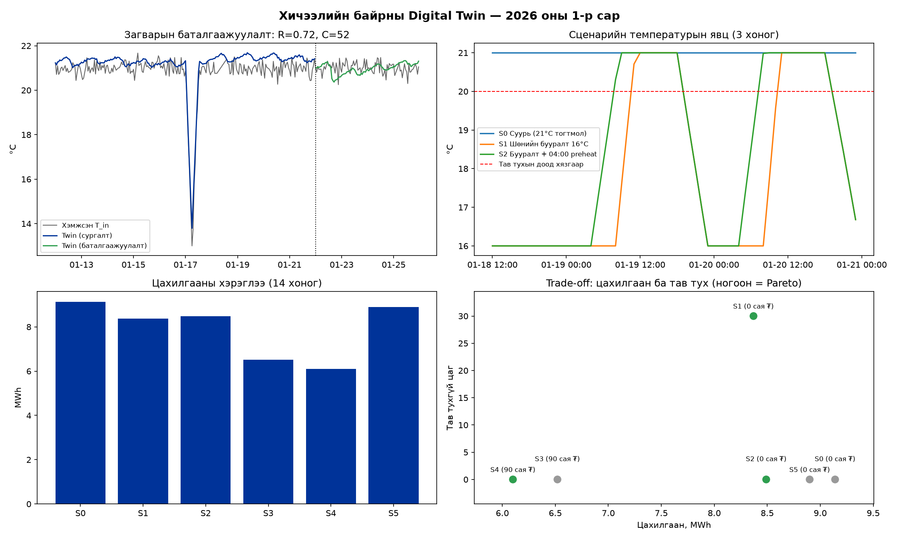

# Building Energy Digital Twin

A digital twin prototype of a university building in Ulaanbaatar, built in one notebook ([digital_twin.ipynb](digital_twin.ipynb)) across the five layers of a digital twin.

| Layer | What it does | Result |
|-------|--------------|--------|
| Data connection | Loads two weeks of hourly sensor data and cleans missing rows, stuck sensors and outliers | Data quality report, 91.1% completeness |
| Digital replica | Physics-based 1R1C thermal model, calibrated by grid search | R = 0.72 K/kW, C = 52 kWh/K, τ = 37.4 h (1,681 simulations, 0.5 s) |
| Validation | Checked against ASHRAE Guideline 14 | Validation CV-RMSE 1.63%, NMBE −0.13% |
| Analytics engine | What-if scenarios: night setback, 04:00 preheat, insulation | Energy, CO₂, cost, comfort and peak-load KPIs in [scenario_results.csv](output/scenario_results.csv) |
| Decision support | Multi-criteria decision analysis (MCDA) and Pareto front | Recommendations for finance and climate stakeholders |

Data: `data/building_sensor_data.csv` (course dataset).
