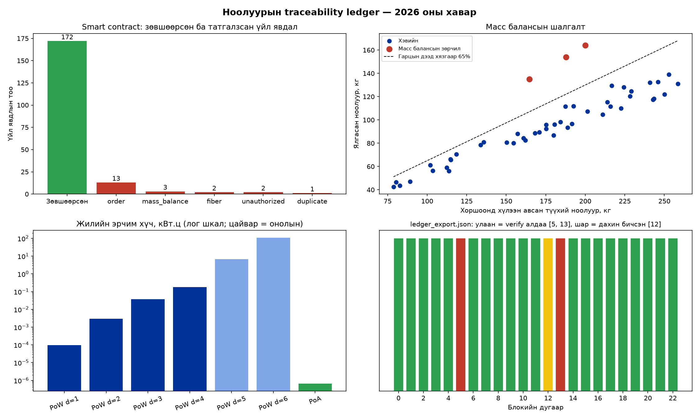

# Blockchain Traceability for Mongolian Cashmere

A simple blockchain ledger in Python for the cashmere supply chain: herder → cooperative → processing factory → exporter. Notebook: [blockchain_traceability.ipynb](blockchain_traceability.ipynb).

- **Cryptography:** SHA-256 hashing and Merkle roots, including a demo of the avalanche effect.
- **Smart-contract rules:** validates order, mass balance, fiber quality, authorization and duplicates; 172 of 193 events accepted, 21 rejected with reasons ([rejected_events.csv](output/rejected_events.csv)).
- **Chain verification:** builds a 23-block chain and detects tampered blocks in an exported ledger (changed quantity and origin aimag).
- **Digital Product Passport:** a passport for batch MNC-2026-001 with Merkle proofs and a carbon footprint of 7.34 kgCO₂e/kg ([dpp_MNC-2026-001.json](output/dpp_MNC-2026-001.json)).
- **Energy footprint:** measured proof-of-work cost at difficulty 1–4 ([consensus_energy.csv](output/consensus_energy.csv)).

Data: `data/` (course dataset: 34 actors, 193 events, 48 batches).
