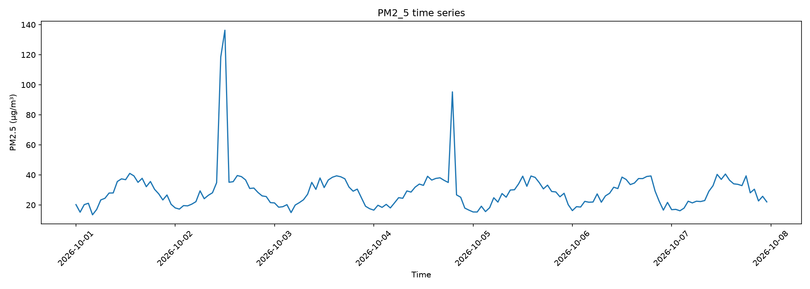
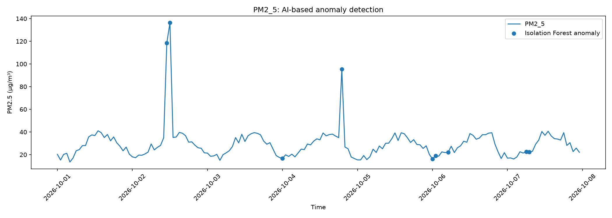
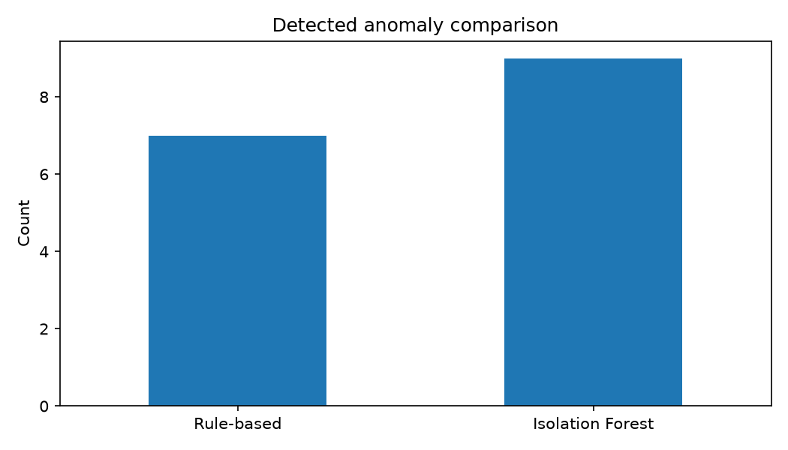
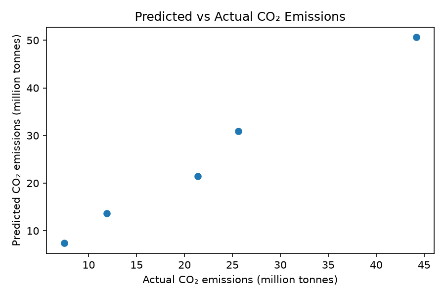

# IoT Air Quality Anomaly Detection

Detects anomalies in hourly PM2.5, CO₂, temperature and humidity readings. Notebook: [iot_anomaly_detection.ipynb](iot_anomaly_detection.ipynb). It generates a 7-day synthetic dataset with labeled anomalies, so it runs as-is.

- Data quality checks: datetime parsing, missing values, duplicates, ordering.
- Rule-based detection with thresholds, then **Isolation Forest** (scikit-learn) on scaled features.
- Evaluation against the labels: the model found every true anomaly (**recall 1.00, precision 0.78, F1 0.88**).

| Time series | Detected anomalies | Method comparison |
|---|---|---|
|  |  |  |

## Extra: CO₂ emissions regression

[co2-regression/](co2-regression) fits a regression model to Our World in Data CO₂ data. Download `owid-co2-data.csv` from [OWID](https://github.com/owid/co2-data) into `co2-regression/data/` to rerun it.

