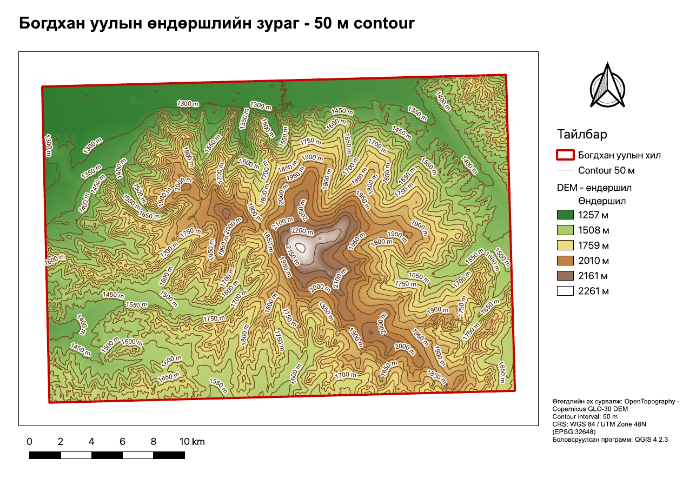
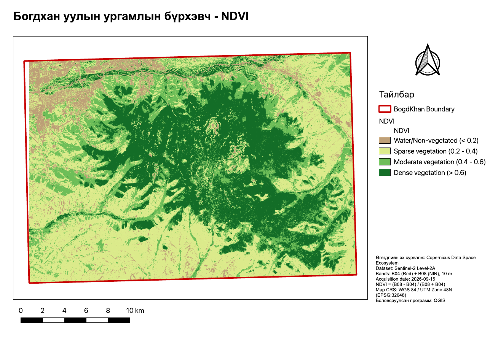

# GIS Analysis of Bogd Khan Mountain

Two maps of Bogd Khan Mountain (Ulaanbaatar) made in QGIS.

1. **Elevation contours:** downloaded a DEM, reprojected it to UTM zone 48N, clipped it to the study area and generated 50 m contour lines.
2. **NDVI vegetation map:** calculated NDVI = (B08 − B04) / (B08 + B04) from Sentinel-2 L2A bands captured on 2026-09-15.

| Contours | NDVI |
|---|---|
|  |  |

Raw rasters (about 200 MB) are not included in this repo.
