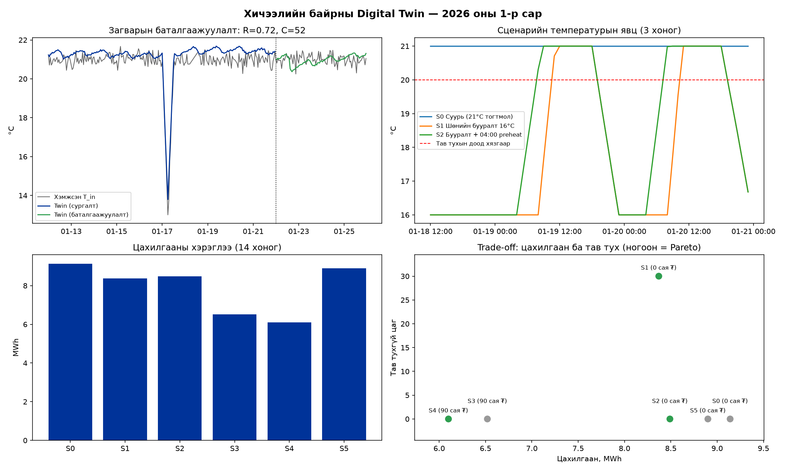

# Digital Sustainability Projects

Five hands-on projects from **Digital Tools for Sustainability** (National University of Mongolia, 2026): a building digital twin, blockchain traceability, IoT anomaly detection, an ESP32 + MQTT monitoring system and GIS analysis.

Notebook comments and labels are in Mongolian; code and results are readable without it.

| # | Project | Stack | Highlight |
|---|---------|-------|-----------|
| 01 | [Building Energy Digital Twin](01-building-energy-digital-twin) | Python, pandas, NumPy, Matplotlib | Calibrated 1R1C thermal model, validated to ASHRAE Guideline 14 (CV-RMSE 1.63%, NMBE −0.13%) |
| 02 | [Blockchain Traceability for Mongolian Cashmere](02-blockchain-cashmere-traceability) | Python, SHA-256, Merkle trees | Tamper detection and a Digital Product Passport with Merkle proofs |
| 03 | [IoT Air Quality Anomaly Detection](03-iot-anomaly-detection) | scikit-learn, pandas | Isolation Forest found every true anomaly (recall 1.00, F1 0.88, synthetic data) |
| 04 | [ESP32 Sensor Monitoring over MQTT](04-esp32-mqtt-monitoring) | MicroPython, Mosquitto, JavaScript | Live web dashboard and remote LED control |
| 05 | [GIS Analysis of Bogd Khan Mountain](05-gis-bogd-khan) | QGIS, Sentinel-2 | Elevation contours and NDVI vegetation map |



## Running the notebooks

```bash
pip install pandas numpy matplotlib scikit-learn jupyter
jupyter notebook
```

Projects 01 and 02 read the course datasets in their `data/` folders. Project 03 generates its own synthetic dataset.

---
Author: **Bilguun Batbaatar**, Software Engineering, National University of Mongolia
